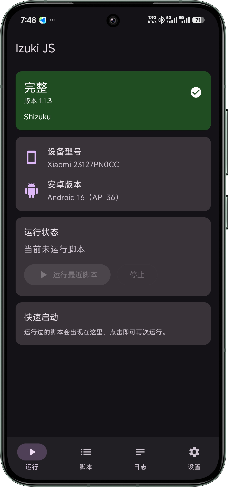
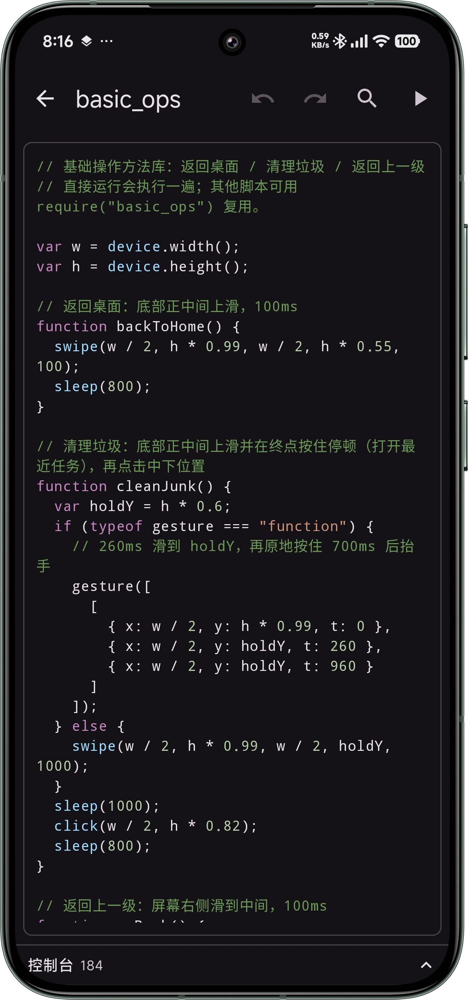
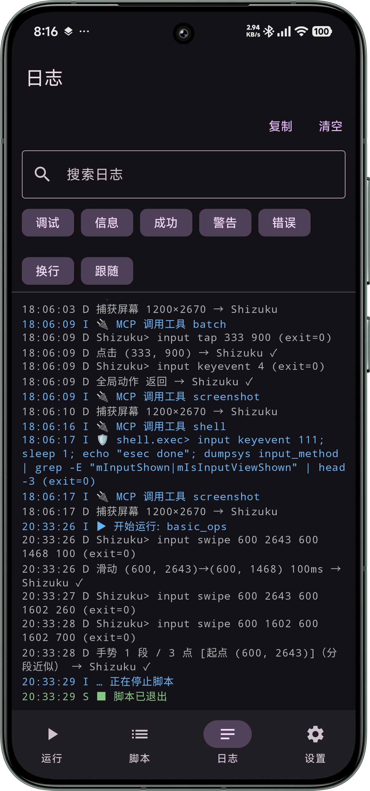
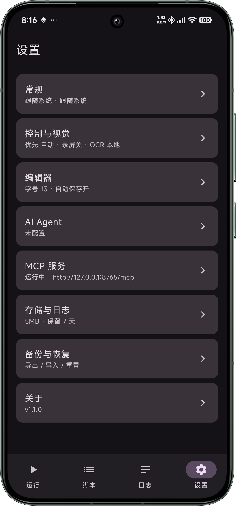

# Izuki JS

[简体中文](README.md) · [English](README_EN.md)

> Izuki 源自日语「いづき」（居付き），意为“常驻、附着”。<br>
> 在自动化脚本的语境下，它代表脚本像影子一样附着在系统之上，安静、持续、可靠地执行任务。<br>
> 后缀 -js 表明它仍可以用 JavaScript 编写脚本，并且让同一份脚本更通用

基于 Kotlin / Jetpack Compose 的 Android 自动化脚本运行环境。用 JavaScript（QuickJS）编写脚本，
组合**无障碍 / Shizuku / Root / 蓝牙 HID** 多种控制后端驱动设备，内置找图找色、OCR 与 AI Agent 脱困能力。

> 交流群 [1081037168](https://qm.qq.com/q/88YNoznH5m) 随时欢迎进来玩，反馈BUG 或者 新功能建议 也可以到这里提

[](LICENSE)
[](https://github.com/BUGJI/IzukiJS/releases)
[]()
[]()

## 界面预览

<p align="center">
  
  
  
  
</p>

<p align="center">
  <sub>运行状态与能力 / 脚本编辑器 / 分级日志 / 全局设置</sub>
</p>

## 特性

- **多控制后端，能力协商与降级**：无障碍、Shizuku、Root、蓝牙 HID 统一抽象为 `Capability`，
  可全局或按能力指定优先级，自动选择当前真正可用的后端。
- **JavaScript 脚本运行时**：基于 QuickJS，每个脚本独立运行时；提供输入、`device` / `app` /
  `selector` / `shell` / `images` / `ocr` / `notify` / `fs` / `http` / `clipboard` /
  `permissions` / `ai` 等接口，并支持用 `// @need` 只暴露脚本真正需要的能力。
- **混合控制**：推荐「无障碍读控件树 + HID/Shizuku 注入输入」——读界面与发指令各取所长。
- **视觉能力**：OpenCV 找图 / 找色，本地 MLKit 中文 OCR 或在线 OCR（百度 / Google Vision / 自定义），
  在线失败自动回退本地。
- **持续录屏截图**：一次授权常驻，为截图 / 找图 / OCR 提供无限屏幕帧，绕开无障碍截图限制。
- **AI Agent 脱困**：脚本卡住时交给 OpenAI 兼容模型观察屏幕并操作设备；支持原生 function calling，
  不支持时自动降级为提示词协议。
- **MCP 服务器**：把设备读屏与控制能力以 Model Context Protocol 暴露给外部 AI 客户端
  （Claude Desktop / Cursor / Cline），支持局域网 / 仅本机监听、令牌鉴权与工具级开关；
  提供运行脚本、读日志、截图资源与脱敏审计日志。
- **蓝牙 HID 注入**：通过外部 HID 硬件（如 ESP32 数位板狗，固件见
  [IzukiJS_HID](https://github.com/BUGJI/IzukiJS_HID)）以真实硬件事件控制设备，适用于需要硬件级输入的场景。
- **系统能力扩展**：按需开启通知监听（`notify.*` 读取 / 等待新通知 / 清除）、使用情况访问
  （`app.foreground()` 等前台与使用记录）、应用列表（`app.list()` 枚举已安装应用）、全部文件访问
  （`fs.*` 读写共享存储）、脚本网络（`http.*`，默认关闭，可配域名白名单）；脚本运行期可保持唤醒
  （可选点亮屏幕），并支持快捷磁贴一键运行固定脚本。
- **调试与工具**：布局分析器生成选择器代码、可拖动调试悬浮窗（布局 / OCR 坐标叠加）、
  悬浮控制条、定时任务（Cron / 充电 / Wi-Fi / 解锁触发、条件过滤、失败重试）、快捷磁贴、
  日志分文件存储与自动清理；脚本编辑器支持 API 补全、标签、版本历史、从光标处运行与
  变量 / 状态查看，运行支持超时与死循环中断。
- **中英双语界面**：内置简体中文与英文，跟随系统语言自动切换。
- **配置备份**：AI / OCR / 控制 / 截图 / 脚本网络 / 日志 / 编辑器偏好一键导出导入，敏感密钥经 Android Keystore 加密。
  由于 Keystore 密钥无法跨设备迁移，系统级自动备份已排除含密文的配置；**换机请使用应用内导出 / 导入**。

## 用途与免责声明

Izuki JS 是一个面向个人设备自动化与无障碍场景的实验性运行时，提供的多种控制后端
旨在让你在自己拥有或明确获授权的设备上编写自动化脚本。

请仅用于合规用途，并遵守当地法律法规及第三方应用的服务条款。本项目按 GPL-3.0
「按原样」提供，不保证稳定性与适用性，使用者需自行承担使用后果。

> HID 注入与 AI Agent 可能触及第三方应用的使用条款，请仅在你有权操作的设备与场景中使用。

## 项目状态

项目处于早期实验阶段，脚本 API 与各后端行为可能随时变更，不建议用于关键任务或生产环境。
欢迎通过 issue 反馈。

## 控制模式与能力

| 能力 | 无障碍 | Shizuku | Root | 蓝牙 HID |
|---|---|---|---|---|
| 手势 / 绝对坐标 | ✅ | ✅ | ✅ | ✅ |
| 键盘 / 文本 | 部分 | ✅ | ✅ | ✅ |
| 读控件树 | ✅ | △ dump | △ dump | ❌ |
| 截图 | ✅(API30+) | ✅ | ✅ | ❌ |
| Shell | ❌ | ✅ | ✅ | ❌ |

> 「读控件树」中 Shizuku / Root 的 `△ dump` 指通过 `uiautomator dump` 获取控件树（约 1~2 秒、
> 偶发失败），用于 AI Agent 读屏兜底；**脚本的 `selector.*` 仍只支持无障碍**。

除控制后端外，「权限与能力」页另有开关式的读取 / 操作辅助能力：通知监听（`notify.*`）、
使用情况访问（`app.foreground()` 等）、应用列表（`app.list()`）、全部文件访问（`fs.*`），
以及保持唤醒 / 点亮屏幕与快捷磁贴（详见 [`docs/TOOLS.md`](docs/TOOLS.md)）。

脚本内可用 `permissions.*` 查询就绪状态，详见 [`docs/SCRIPT_API.md`](docs/SCRIPT_API.md)。

## 快速开始

### 方式一：下载安装（推荐）

从 [Releases](https://github.com/BUGJI/IzukiJS/releases/latest) 下载 APK，按设备架构选择其一：

| 文件 | 适用设备 |
|---|---|
| `app-arm64-v8a-release.apk` | 绝大多数现代手机（首选） |
| `app-armeabi-v7a-release.apk` | 较老的 32 位设备 |
| `app-x86_64-release.apk` | 模拟器 / x86 平板 |

安装时若提示「未知来源」，需在系统设置中允许该来源。本 App 会用到无障碍 / Shizuku / Root
等较高权限，请只安装可信来源的包。

> Release 包未配置正式签名时会回退为 debug 签名（见下方「构建」），仅用于分发验证；
> 自行构建正式签名版请按下文配置 `keystore.properties`。

### 方式二：从源码构建

#### 环境要求

- Android 9（API 28）及以上
- 构建：JDK 17（运行 Gradle 所需；源码兼容级别为 Java 11）、Android SDK（`compileSdk 37`）、
  Android NDK `27.1.12297006`、CMake `3.22.1`（用于 QuickJS 中断回调的 JNI 垫片）

#### 构建

```bash
# 克隆
git clone https://github.com/BUGJI/IzukiJS.git
cd IzukiJS

# 构建 Debug
./gradlew :app:assembleDebug

# 构建 Release（未配置签名时回退 debug 签名，仅用于本地验证）
./gradlew :app:assembleRelease
```

正式签名：复制 `keystore.properties.example` 为 `keystore.properties` 并填入密钥信息
（该文件已被 `.gitignore` 忽略，不会提交）。

产物按 ABI 拆分：`arm64-v8a` / `armeabi-v7a` / `x86_64`。

### 首次使用

1. 打开 App，在「运行 → 权限与能力」按「读取 / 操作 / 其他」分组按需开启：
   - **无障碍**：跳转系统无障碍设置开启（读控件树、API30+ 截图、基础手势）。
   - **Shizuku**：先安装并启动 Shizuku，再在 App 内授权（输入注入、截图、Shell）。
   - **Root**：检测 Root 并通过 `su` 授权。
   - **蓝牙 HID**：扫描并连接外部 HID 数位板狗。
   - **其他能力**（开关式）：通知监听、使用情况访问、应用列表、全部文件访问、保持唤醒 /
     点亮屏幕、快捷磁贴。

2. 需要无限截图时，在「权限与能力」中授权「屏幕捕获」一次并开始。
3. 在「脚本」页新建脚本，编辑并运行；编辑器支持 JS 语法高亮、查找替换、撤销重做、
   API 补全与版本历史，脚本支持标签与按名称 / 标签搜索。
   可在脚本中心将常用脚本「钉到磁贴」或加入定时任务。

> 提示：脚本运行时可以收回非必要权限，只保留当前脚本真正需要的模式，减少不必要的权限占用。

## 脚本示例

```js
// 打开应用 → 等待登录按钮 → 点击
app.launch("com.example.app");
sleep(1500);

var hit = ocr.find("登录");
if (hit) {
  click(hit.x, hit.y);
  log("已点击登录 @ " + hit.x + "," + hit.y);
} else {
  toast("未找到登录按钮");
}

// 读控件树点击
if (selector.existsById("com.example.app:id/confirm")) {
  selector.clickById("com.example.app:id/confirm");
}

// 卡住时交给 AI 脱困
if (ai.available()) {
  ai.run("关闭广告弹窗并回到首页。屏幕文字：" + ocr.recognize(), {
    maxSteps: 6,
    onTool: function (name, args) { log("→ " + name + " " + args); }
  });
}
```

完整 API 见 [`docs/SCRIPT_API.md`](docs/SCRIPT_API.md)。

## 文档

| 文档 | 内容 |
|---|---|
| [`docs/SCRIPT_API.md`](docs/SCRIPT_API.md) | 脚本 API 速查：全局函数、输入、选择器、找图、OCR、AI 等 |
| [`docs/TOOLS.md`](docs/TOOLS.md) | 工具与权限说明：控制模式、持续录屏、调试悬浮窗、定时任务、日志 |
| [`docs/BLE_HID_PROTOCOL.md`](docs/BLE_HID_PROTOCOL.md) | 蓝牙 HID 控制协议：GATT 服务、帧格式、坐标映射、连接流程 |
| [`docs/MCP.md`](docs/MCP.md) | MCP 服务器：启用、客户端配置、工具与资源、安全说明 |
| [`CHANGELOG.md`](CHANGELOG.md) | 版本变更记录 |

## 项目结构

```
app/src/main/java/com/benton/izukijs/
├── ai/            # AI Agent：配置、客户端、工具调用、提示词
├── mcp/           # MCP 服务器：JSON-RPC 协议、HTTP 传输、工具与资源
├── controller/    # 控制抽象层与各后端实现
│   ├── accessibility/  # 无障碍
│   ├── shizuku/        # Shizuku
│   ├── root/           # Root
│   ├── hid/            # 蓝牙 HID（协议 / GATT 客户端 / 控制器）
│   └── shell/          # 命令后端
├── runtime/       # QuickJS 运行时与脚本 API 绑定（runtime/api）
├── ocr/           # 本地 MLKit / 在线 OCR 引擎
├── service/       # 前台服务：脚本、悬浮窗、调试叠加、录屏、通知监听、快捷磁贴
├── schedule/      # 定时任务与开机重注册
├── data/          # 脚本仓库、编辑器设置、配置备份
├── security/      # 密钥加密
├── ui/            # Compose 界面（run / scripts / editor / settings / ...）
└── model/         # ControlMode / Capability 等

app/src/main/cpp/  # QuickJS 中断回调 JNI 垫片
```

## 技术栈

- Kotlin 2.2.10 · Jetpack Compose（Material 3）· Navigation Compose
- [QuickJS-Android](https://github.com/taoweiji/quickjs-android)（`com.github.hjhrq1991:quickjs-android`，采用 16KB 页大小兼容的修复分支，经 JitPack 分发）
- [Shizuku](https://shizuku.rikka.app/) · OpenCV · MLKit 中文文字识别
- Kotlin Coroutines · Timber

## 安全

- **本机生成、本地加密**：MCP 访问令牌在设备本地生成，经 Android Keystore（`SecretCipher`）
  加密存储，不会上传到任何服务器；可在设置页「重新生成」以轮换。
- **网络监听**：MCP 默认「仅本机」（配合 `adb forward`），也可切换为局域网
  （同一 Wi-Fi 下的设备可访问）。任何持有令牌者都可读屏并控制设备，请仅在可信网络中使用。
- **默认最小权限**：`shell` 与脚本执行默认关闭，需在设置页显式开启；高危命令默认拦截。
  完整说明见 [`docs/MCP.md`](docs/MCP.md)。

## 许可证

本项目基于 [GNU General Public License v3.0](LICENSE) 发布。

```
Copyright (C) 2026 BUGJI

This program is free software: you can redistribute it and/or modify
it under the terms of the GNU General Public License as published by
the Free Software Foundation, either version 3 of the License, or
(at your option) any later version.
```
